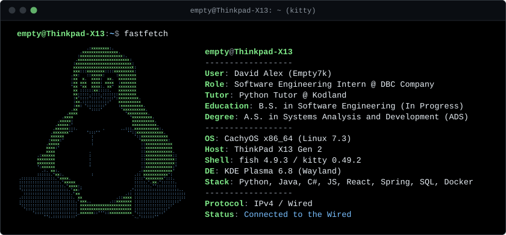

  

 

<samp><b>$ cat about_me.txt</b></samp>

> Software Engineering student and **Systems Analysis & Development (ADS)** graduate, currently working as a **Software Engineering Intern @ DBC Company** and **Python Tutor @ Kodland**.  
> Passionate about building clean, reliable software with **Python, Java, C#, and JavaScript/React**, working with **Spring, SQL, and Docker**, and tinkering with my **Linux** workflow.

  
  
  
  
  
  
  
  
  
  
   
  
  

 

  
  

  

